<p align="center">
  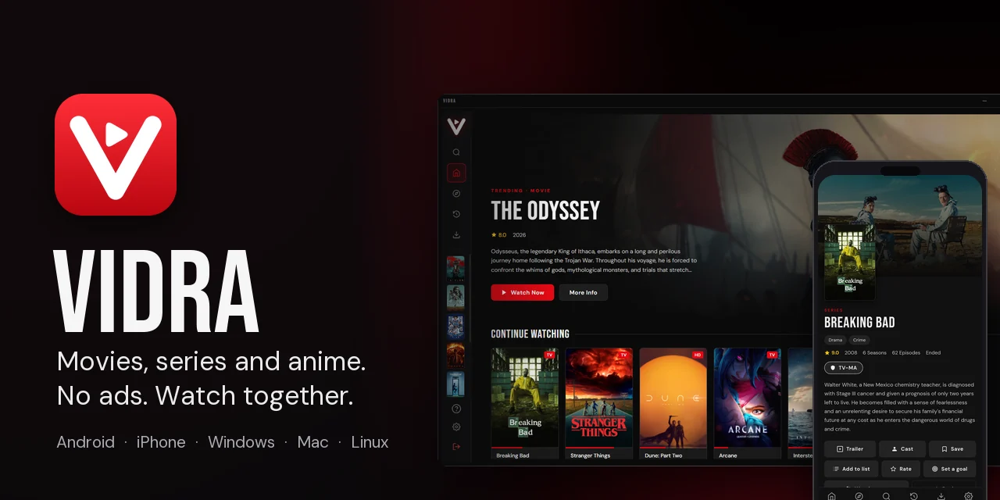
</p>

<p align="center">
  <a href="https://github.com/SoloHandCoder/vidra-desktop/releases/latest"></a>
  <a href="https://github.com/SoloHandCoder/vidra-desktop/releases"></a>
  
  <a href="LICENSE"></a>
</p>

<p align="center">
  <a href="https://github.com/SoloHandCoder/vidra-desktop/releases/latest"></a>
  <a href="https://github.com/SoloHandCoder/vidra-desktop/releases/latest"></a>
  <a href="https://github.com/SoloHandCoder/vidra-desktop/releases/latest"></a>
</p>

<p align="center">
  Also on <a href="https://github.com/SoloHandCoder/vidra-android"><b>Android</b></a> and <a href="https://github.com/SoloHandCoder/vidra-ios"><b>iPhone &amp; iPad</b></a>. Your library syncs between all of them.
</p>

<p align="center">
  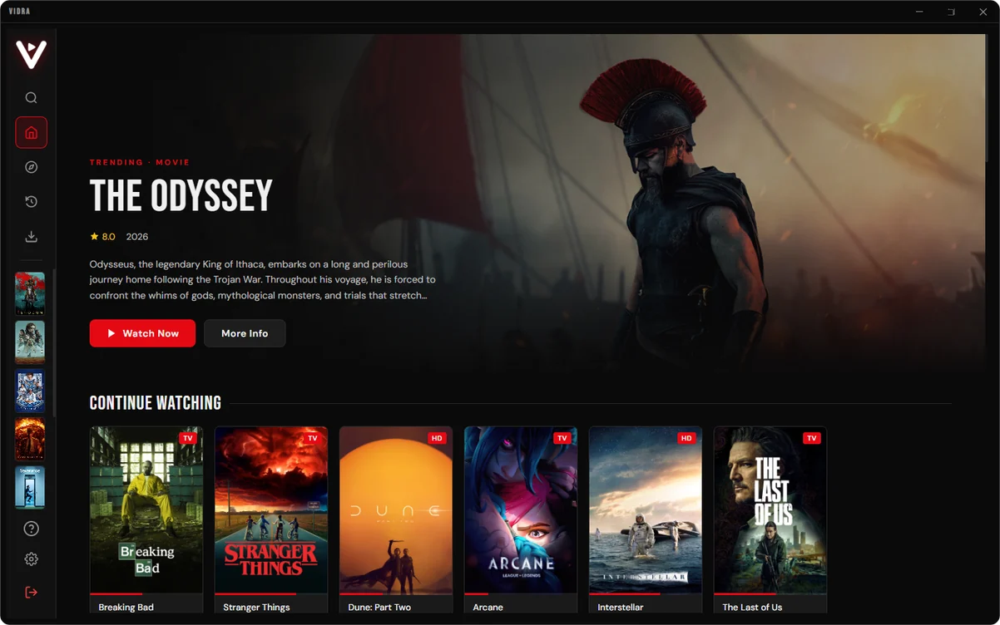
</p>

## ✨ What you get

<table>
<tr>
<td width="50%" valign="top">

**🎬 Everything in one place**<br>
Movies, series and anime with posters, trailers, cast and ratings. "Because you watched…" rows, a Discover page with collections, genres and filters, and pages for actors and directors.

**👥 Watch parties**<br>
Play, pause and skipping stay in sync with friends on other computers and phones. Chat, emoji reactions, a host, a ready check with a 3‑2‑1 countdown, a shared queue and polls. End‑to‑end encrypted.

**⏭️ Up next**<br>
When the credits roll, the next episode starts after a short countdown, and the one you finished is marked as watched.

**📥 Downloads**<br>
Download movies or whole seasons in the quality you pick and play them in the built‑in player. Smart downloads fetch the next episodes for you.

</td>
<td width="50%" valign="top">

**☁️ Sync and profiles**<br>
Watchlist, progress, ratings, lists and stats sync with your phone. Everyone gets a profile; kids profiles have an age limit and a PIN.

**🎨 Make it yours**<br>
Eleven themes plus Auto, any accent colour, subtitle size, colour and timing, and six app languages.

**🔔 Never miss an episode**<br>
Release reminders, a calendar of what's coming, Trakt sync, watch‑time goals and a yearly recap card.

**🛡️ Clean and fast**<br>
Ads and trackers are blocked, popups can't hijack the player, and it streams straight from the source. Chromecast, taskbar shortcuts and Discord status included.

</td>
</tr>
</table>

## 📸 A closer look

<table>
<tr>
<td width="50%">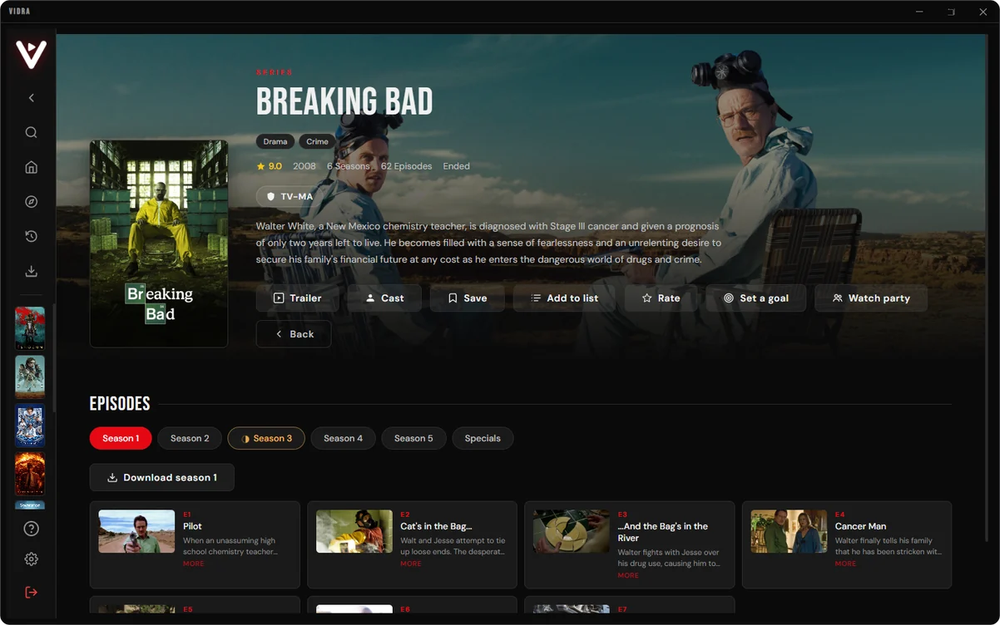<p align="center"><sub><b>Shows:</b> seasons, episodes, your progress</sub></p></td>
<td width="50%">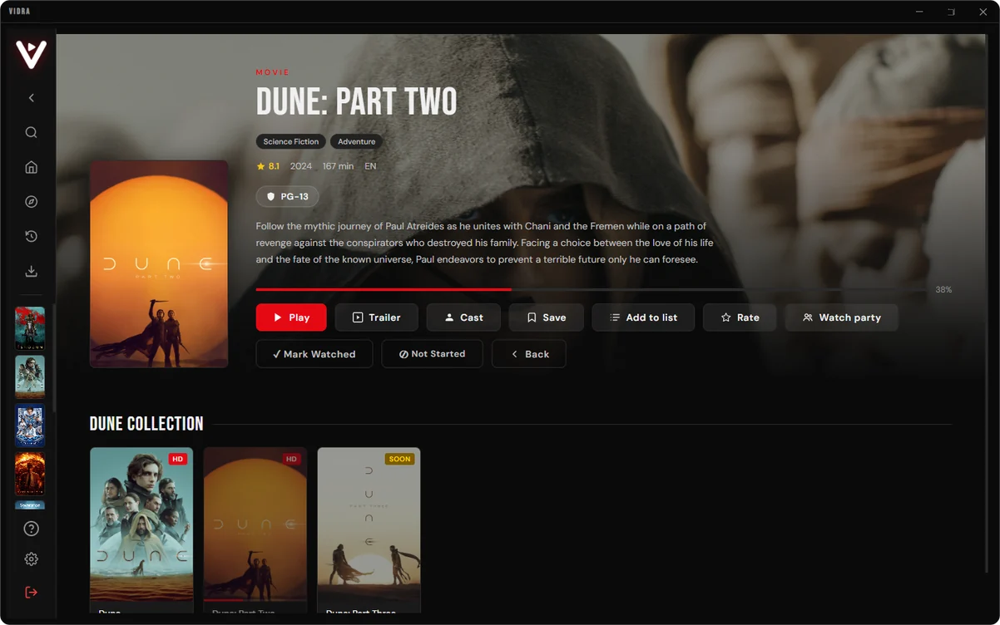<p align="center"><sub><b>Movies:</b> collections, trailers, cast</sub></p></td>
</tr>
<tr>
<td width="50%">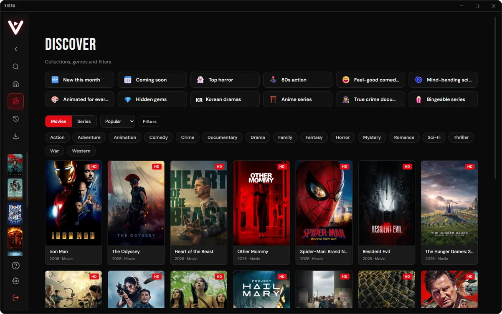<p align="center"><sub><b>Discover:</b> collections, genres, filters</sub></p></td>
<td width="50%">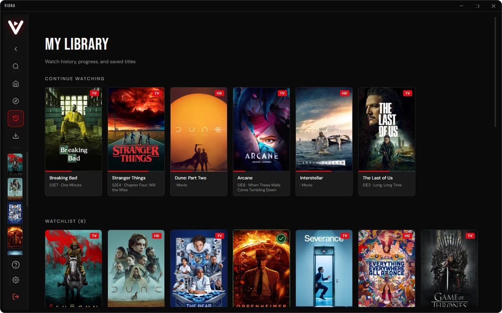<p align="center"><sub><b>Library:</b> continue watching, watchlist, stats</sub></p></td>
</tr>
<tr>
<td width="50%">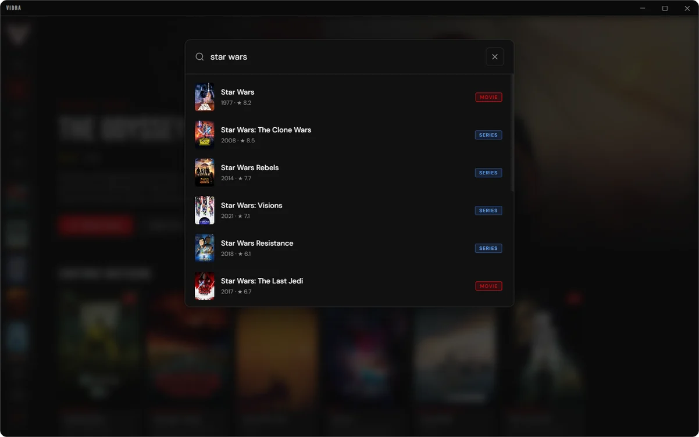<p align="center"><sub><b>Search:</b> movies, series and anime at once</sub></p></td>
<td width="50%">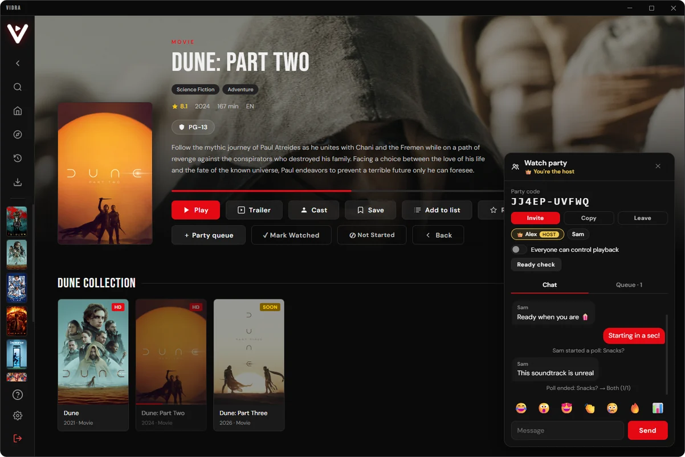<p align="center"><sub><b>Watch party:</b> chat, host controls, queue</sub></p></td>
</tr>
</table>

## 🎉 Watch together

<p align="center">
  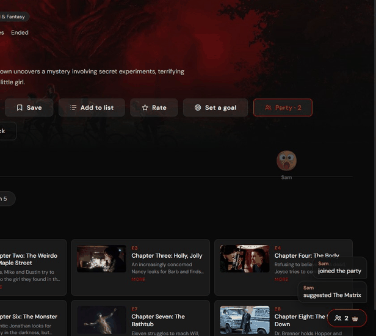
</p>

1. Open a movie or show and click **Watch party → Start a party**.
2. Click **Invite** and send the link, or just the code. Friends can join from Windows, Mac, Linux, Android or iPhone.
3. Watch in sync. Messages and reactions pop up over the video.

**The host** decides who controls playback, runs a **ready check** so everyone starts together, keeps the **queue** of what's next and can start a **poll** about it.

## 🎨 Themes

<p align="center">
  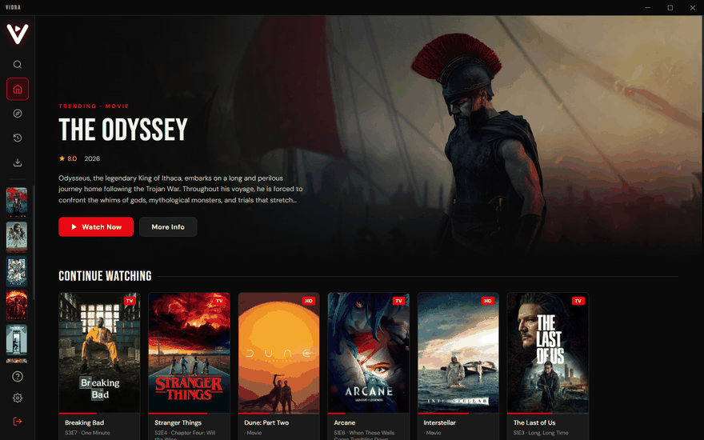
</p>

<details>
<summary>All themes side by side</summary>
<p align="center">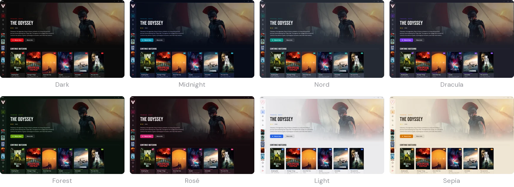</p>
</details>

## 📱 On your phone too

<p align="center">
  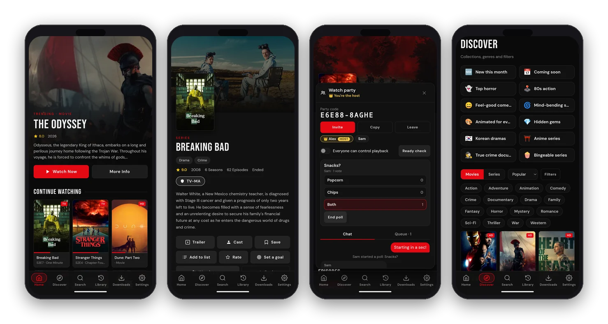
</p>
<p align="center">
  <a href="https://github.com/SoloHandCoder/vidra-android"><b>Vidra for Android</b></a> · <a href="https://github.com/SoloHandCoder/vidra-ios"><b>Vidra for iPhone &amp; iPad</b></a>
</p>

## 💻 Install

### Windows
Download the latest **`Vidra-Setup-*.exe`** from **[Releases](https://github.com/SoloHandCoder/vidra-desktop/releases/latest)** and run it.

Updates are built in on every system: Settings → **Check for updates**.

### macOS
Download **`Vidra-*-universal.dmg`** (Intel and Apple Silicon), open it and drag Vidra to Applications.

Vidra isn't signed with an Apple developer certificate, so the first time macOS may say it **"can't be opened"** or **"is damaged"**. Right-click Vidra in Applications → **Open** → **Open**. If macOS still refuses, run this once in Terminal:
```bash
xattr -cr /Applications/Vidra.app
```

### Linux
Pick the file for your system from **[Releases](https://github.com/SoloHandCoder/vidra-desktop/releases/latest)**:
```bash
# any distro: AppImage (also works with Gear Lever)
chmod +x Vidra-*-x86_64.AppImage && ./Vidra-*-x86_64.AppImage

# Debian, Ubuntu, Mint
sudo apt install ./Vidra-*-amd64.deb

# Fedora, openSUSE
sudo dnf install ./Vidra-*-x86_64.rpm

# Arch, Manjaro
sudo pacman -U Vidra-*-x86_64.pacman
```

### First start
Paste your free **TMDB read access token** ([how to get one](tmdb-tutorial.md)). It's stored on your computer and used to load titles, posters and info. Subtitles from Wyzie need a free key too ([guide](wyzie-tutorial.md)).

> [!NOTE]
> Vidra was called **Streambert Desktop** until 2.18. It installs over the old app as an update and keeps all your data.

## ❓ FAQ

<details>
<summary><b>Is it free? Are there ads?</b></summary>

Free and open source. There are no ads in the app, and ad and tracker requests from the video sources are blocked as well as possible.
</details>

<details>
<summary><b>Where do the videos come from?</b></summary>

Vidra loads information from <a href="https://www.themoviedb.org/">TMDB</a> (and <a href="https://anilist.co/">AniList</a> for anime) and plays streams from third-party embed sources, listed in <code>src/utils/api.js</code>. Downloads save those streams (HLS playlists) to your computer.
</details>

<details>
<summary><b>How does sync work?</b></summary>

Settings → Cloud Sync. Your data goes into a private GitHub Gist under your own account (the token only needs the <code>gist</code> permission). There's no Vidra server.
</details>

<details>
<summary><b>Do my friends need Vidra for a watch party?</b></summary>

Yes, on any platform. Everyone should pick the same source. Messages go through a public relay but are end‑to‑end encrypted with the party code, so the relay only sees scrambled data.
</details>

## 🔧 Building from source

Requirements: [Node.js](https://nodejs.org/) 22.12 or newer.

```bash
npm install
npm start            # run it
npm run dist:win     # Windows installer
npm run dist:mac     # macOS (universal .dmg)
npm run dist:linux   # Linux (.AppImage, .deb, …)
```
Other targets: `dist:appimage`, `dist:deb`, `dist:rpm`, `dist:arch`, or `dist` for all of them.

> [!IMPORTANT]
> On Arch Linux you may need `libxcrypt-compat` (for a `libcrypt.so.1` error) and `http-parser` from the AUR.

<details>
<summary><b>Project structure</b></summary>

```
index.js            main process: windows, sessions, ad blocking, lifecycle
preload.js          the window.electron API for the UI
src/
├── App.jsx         the app shell and routing
├── pages/          Home, Movie, TV, Library, Downloads, Settings
├── components/     cards, modals, player bits, sidebar
├── extras/         features shared with the phone apps (Discover, party, goals, …)
├── ipc/            main-process handlers: downloads, player, subtitles, cast, links
├── sync/           cloud sync (GitHub Gist)
└── utils/          TMDB API, storage, ratings, updates, appearance
public/             icons, the built-in player (sb-player.*)
```
</details>

## 💛 Credits

Vidra is based on **[Streambert](https://github.com/truelockmc/streambert)** by truelockmc. All credit for the original app goes to them. Ideas and bug reports for Vidra are welcome in this repo's issues; changes to the core app are best sent to the original project.

Movie and show data comes from [TMDB](https://www.themoviedb.org/); Vidra isn't endorsed or certified by TMDB.

## 🔒 Privacy

Vidra doesn't collect any data and doesn't depend on a server of its own. The video sources, TMDB, and GitHub (for updates and sync) can still see your requests. Ad and tracker blocking is built in, but no blocker is perfect.

## ⚖️ Legal

Vidra is for personal and educational use. It doesn't host, store or distribute any content: it shows information from TMDB and plays what third-party websites provide, like a search engine. You are responsible for making sure you're allowed to watch what you open, under the laws where you live. Please support creators through legal services.

Licensed under the [GPL-3.0](LICENSE). Forks must stay open source.
